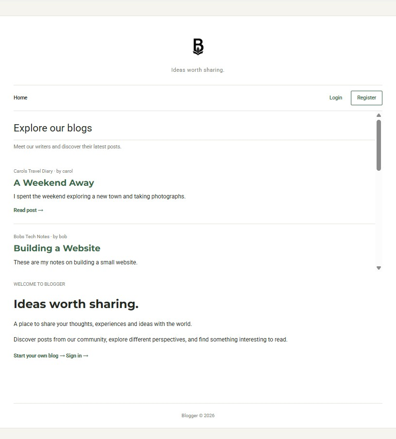
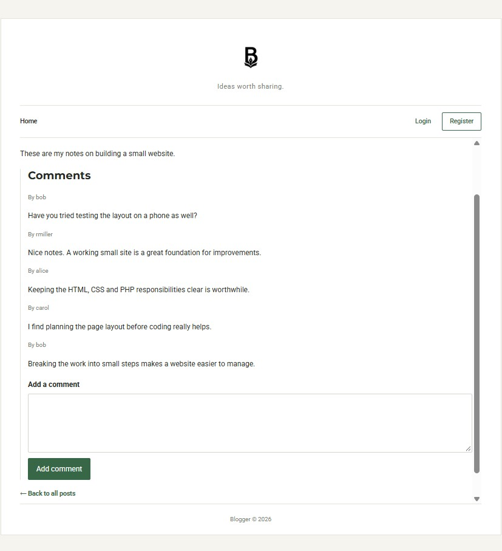
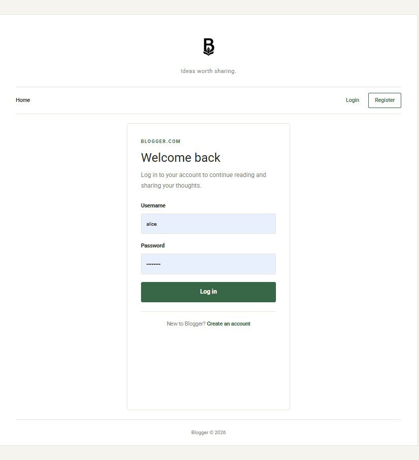
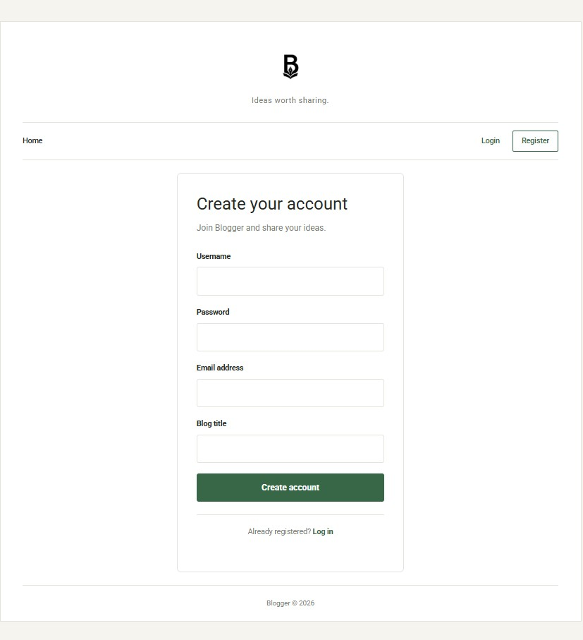
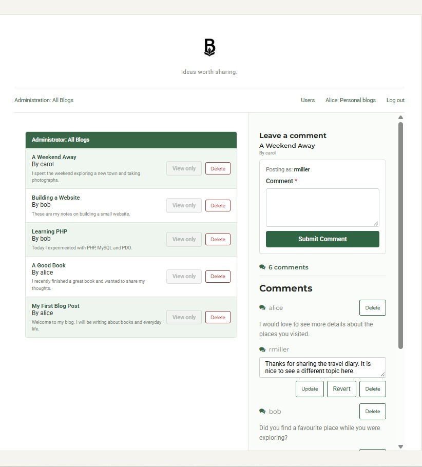
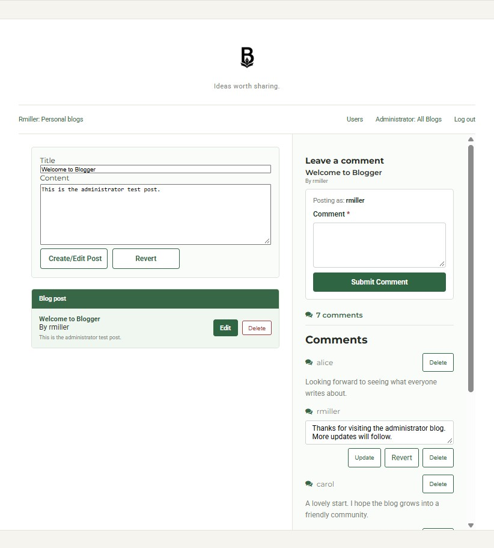
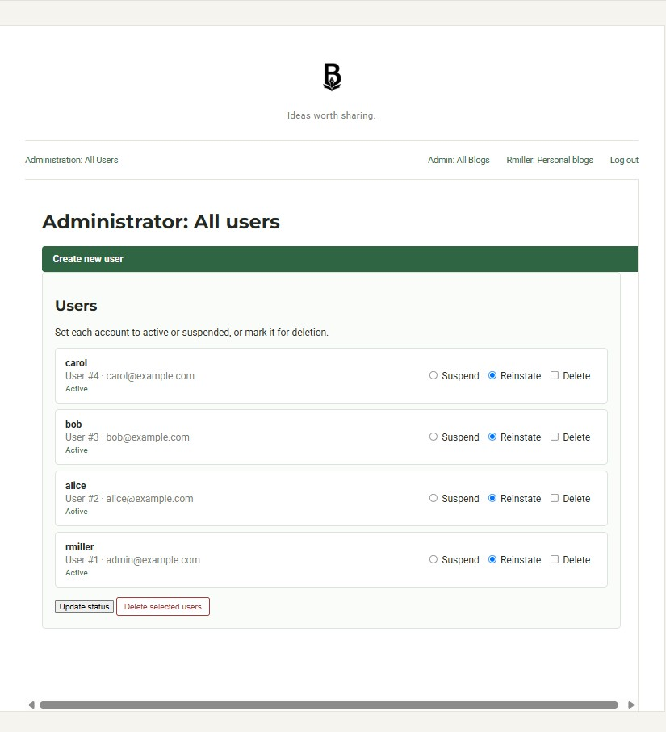
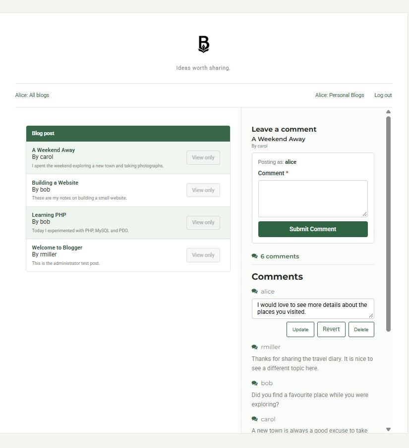
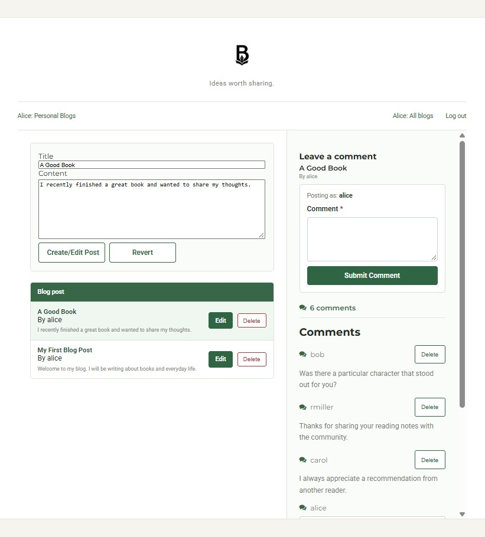
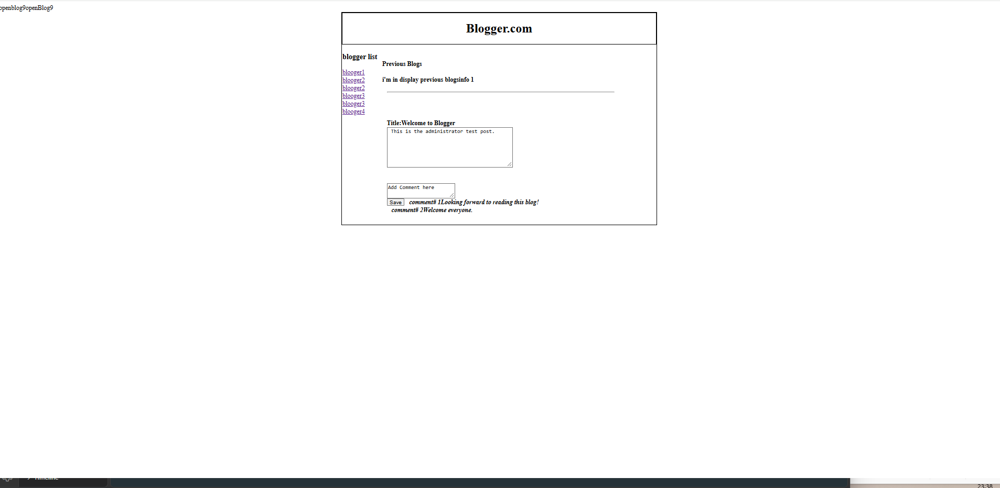

# Blogger

A revamp of a 2014 blogging platform, using the original project as a reference to restore its functionality and develop a simple, modern graphical user interface.

## Project Screenshots

The screenshots below use the image paths supplied for the project. GitHub renders repository image paths most reliably with forward slashes.

### Public pages

<p>
  
  
  
   
</p>

### Administration and blogger views

<p>
  
  
  
  
  
 
</p>

> If an image does not display on GitHub, check that its filename and letter case match the file in the repository exactly.

## Overview
---

Blogger is a simple PHP/MySQL blogging application originally developed in **2014 as part of a Higher Diploma in Cloud Computing**. This updated project uses the original application as a reference to restore its functionality and provide a clearer, more modern graphical interface while retaining its legacy PHP/MVC-style structure.



The application demonstrates server-side PHP programming, MySQL database interaction, user registration and authentication, blog posts, comments, and basic administration.

### Project goals

- Preserve and understand the original application's behaviour.
- Restore core blogging and administration functionality.
- Improve the consistency and usability of the interface without undertaking an unnecessary full rewrite.
- Refine the legacy code incrementally, using clearer names and shared view components where practical.

## Project Features
---

### General functionality

- Register and log in.
- Log out of an authenticated session.
- Browse blog posts and other bloggers.
- Create, view, update, and delete blog posts where permitted.
- Add and read comments.
- Manage users and blogs through the administrator interface.
- Suspend and reinstate users.

### Main application views

The current interface is organised around seven principal views:

1. **Guest Home** — browse the blog collection.
2. **Guest Individual Blog** — read a selected post and its comments.
3. **Blogger: All Blogs** — browse blogs through the blogger interface.
4. **Blogger: Personal Blog** — manage personal posts and view comments for the selected post.
5. **Administrator: All Blogs** — review and manage the blog collection.
6. **Administrator: All Users** — manage user accounts and their status.
7. **Administrator: Personal Blog** — manage the administrator's own posts and comments.

The administrator and blogger personal-blog screens share an implementation where practical, helping keep the layout and comment handling consistent.

## Architecture
---

The application follows a traditional PHP/MVC-like structure. A central controller routes requests to view classes, and a database manager performs database operations.

```text
Browser
   |
   v
controller.php
   |
   +-- command from GET or POST
   |
   v
View classes
   |
   v
DBManager
   |
   v
MySQL database
```

### `controller.php`

The main entry point. It reads the `cmd` parameter from `$_POST` or `$_GET` and uses a `switch` statement to select the requested operation.

Examples of command names used by the application include:

```text
login
register
loginRequest
registerBlogger
addPost
openblog
openblog1
addComment
delete1
deleteUser
Suspend
logout
```

The controller's current command routing is the source of truth; command names should not be changed as part of a CSS-only adjustment.

### `library.php`

Contains the application's view classes and the `DBManager` class. Despite its filename, it includes PHP application logic and generated HTML; it is not a CSS library.

Key view classes include:

- `PublicBaseView` — shared layout for public-facing pages.
- `AuthenticatedBaseView` — shared layout for authenticated pages.
- `HomeView` — public welcome page and blog listing.
- `LoginView` — login form.
- `RegistrationView` — registration form.
- `SinglePostView` — individual post and comments.
- `AdminDashboardView` — administrator blog and comment management.
- `AdminBlogManagementView` — personal-blog management interface shared by the administrator and blogger.
- `AdminUsersView` — administrator user management.
- `PreviousPostsView`, `GuestPostView`, `CreatePostView`, `BlogPostManagementView`, `DeleteBlogPostsView`, `SuspendUsersView`, and `DeleteUsersView` — additional legacy views retained in the project.

Some older views remain for compatibility or historical context; their presence does not necessarily mean they are part of the main current navigation.

### Database manager naming refactor

Several `DBManager` methods have been renamed to describe their responsibilities more clearly. The intention is to preserve implementation and database behaviour while making the code easier to read. Comments in the source identify former names where applicable.

| Former name | Current name |
| --- | --- |
| `processLogin()` | `authenticateUser()` |
| `getBlogindex()` | `getUserBlogDetails()` |
| `addBlogger()` | `registerBlogger()` |
| `getMostRecentPostId()` | `getLatestPostId()` |
| `retrieveAdminBlogPosts()` | `displayAdminBlogPosts()` |
| `retrieveallblogsanddisplay()` | `displayAllBlogPosts()` |
| `retrieveallblogsanddisplay1()` | `displayPostsForDeletion()` |
| `outerretrieveallblogsanddisplay()` | `displayBloggerLinks()` |
| `retrieveuserblogsanddisplay()` | `displayUserPostsForDeletion()` |
| `retrievebody()` | `displayPostBodyInTextarea()` |
| `getDetailsanddisplay()` | `buildPostBloggerDetails()` |
| `deleteBloogs()` | `deleteSelectedUserPosts()` |
| `deleteBloogs1()` | `deleteSelectedPosts()` |
| `retrieveallusersdisplay()` | `displayUsersForDeletion()` |
| `retrieveallusersdisplay1()` | `displayUsersForSuspension()` |
| `retrieveuserdetails()` | `displayUserDetails()` |
| `displayUsers()` | `displayUserCheckboxes()` |
| `deleteUsers()` | `deleteSelectedUsers()` |
| `SuspendUsers()` | `updateUserSuspensionStatus()` |
| `displayPreviousBlogs()` | `displayPreviousPosts()` |
| `displayPreviousBlogs1()` | `displayPreviousPostsWithAlternativeComments()` |
| `renderPreviousBlogs()` | `renderPreviousPostsWithComments()` |
| `deleteCommentsForPost()` | `deleteSelectedCommentsForPost()` |
| `processBlog()` | `createBlogPost()` |
| `processFirstBlog()` | `createInitialBlogPost()` |

The constructor and already descriptive methods such as `getPostById()` and `getCommentsForPost()` retain their existing names.

### View class naming refactor

Numbered legacy view names were replaced with descriptive names. The intent was to improve readability while preserving routing and behaviour. The source includes comments identifying former class names.

| Former class name | Current class name |
| --- | --- |
| `OutsideView` | `PublicBaseView` |
| `InsideView` | `AuthenticatedBaseView` |
| `View1` | `HomeView` |
| `View2` | `LoginView` |
| `View3` | `PreviousPostsView` |
| `View31` | `GuestPostView` |
| `View4` | `RegistrationView` |
| `View5` | `CreatePostView` |
| `View51` | `BlogPostManagementView` |
| `View6` | `DeleteBlogPostsView` |
| `ViewSinglePost` | `SinglePostView` |
| `AdminViewMessages` | `AdminBlogManagementView` |
| `View8` | `SuspendUsersView` |
| `View9` | `DeleteUsersView` |

`AdminBaseView`, `AdminDashboardView`, and `AdminUsersView` were retained because their names already describe their responsibilities.

### CSS and JavaScript

The application uses separate stylesheets for the public and authenticated areas:

- `myStyles.css` — public pages.
- `insidestyles.css` — authenticated and administration pages.

JavaScript supports selected interface interactions. The application remains based on PHP routes and form submissions; core navigation and server-side validation should not depend solely on JavaScript.

Recent UI work focuses on consistent typography and spacing, clearer controls, confirmation for destructive actions, prevention of duplicate submissions, and a two-pane layout for post management and comments. The existing PHP routes, database behaviour, authentication flow, and server-side permissions remain authoritative.

Further implementation details and acceptance criteria are documented in [`UI-AND-JAVASCRIPT-CHANGE-OUTLINE.md`](UI-AND-JAVASCRIPT-CHANGE-OUTLINE.md), if that file is present in the repository.

## Database
---

The application uses a MySQL database named `blogger`.

The original connection configuration was:

```text
mysql:host=localhost:3306;dbname=blogger
```

The local development setup may use a different port; update the connection settings to match the environment.

The three principal tables are:

```text
user
post
comments
```

### `user`

Stores user and administrator information, including fields such as:

- `id`
- `username`
- `password`
- `blogtitle`
- `email`
- `suspend`

### `post`

Stores blog posts, including:

- `id`
- `bloggerid`
- `title`
- `body`

`bloggerid` associates a post with its owner.

### `comments`

Stores comments associated with posts, including:

- `id`
- `postid`
- `body`
- `author`

`postid` associates a comment with a blog post.

```text
user
  |
  | user.id
  v
post
  |
  | post.id
  v
comments.postid
```

Use the schema and database scripts in the repository as the definitive reference for table definitions and relationships.

## Authentication and Permissions
---

The original application uses a legacy cookie-based login mechanism. The administrator account is identified in the application logic by the username `rmiller`.

The current implementation's controller, database code, and permission checks define the actual access rules. The interface should reflect those rules, but hiding a button is not a substitute for server-side authorization.

**Security note:** The original code was written in 2014 and should be treated as an educational project, not production-ready software. Before any public deployment, review password storage, session handling, SQL query construction, input validation, output escaping, error handling, and authorization checks.

## Main User Flows
---

### Registration

```text
Registration form
      |
      v
controller.php
      |
      v
registerBlogger
      |
      v
DBManager
      |
      v
user table
```

### Login

```text
Login form
      |
      v
controller.php
      |
      v
loginRequest
      |
      v
handleLogin()
      |
      v
DBManager::authenticateUser()
```

### Creating a post

```text
Post form
    |
    v
controller.php
    |
    v
addPost
    |
    v
handleAddpost()
    |
    v
DBManager::createBlogPost()
    |
    v
post table
```

### Comments

Comments are submitted through controller commands such as `addComment` and `addComment1`, depending on the view and flow being used.

## Local Setup
---

### Requirements

- PHP
- MySQL-compatible database
- Web browser
- Project source code and required database setup scripts

### Run the application

1. Clone or download the repository.
2. Configure the database connection for your local MySQL instance.
3. Create or import the `blogger` database and required tables.
4. From the project directory, start PHP's built-in development server. For example, on Windows where PHP is installed at the following path:

   ```powershell
   & "C:\php-8.4.26\php.exe" -S localhost:8000
   ```

5. Open `http://localhost:8000` in your browser.

Do not commit database passwords or other secrets. The credentials shown in historical source code should not be reused for a public or production environment.

## Testing
---

Manual testing should cover the main views and role-based actions.

- Check that the guest home page lists posts and public navigation works.
- Open an individual post and confirm its content and comments are displayed.
- Test login, logout, and registration.
- Test post creation, editing, and deletion using accounts with appropriate permissions.
- Confirm the comments shown correspond to the selected post.
- Verify that comment controls match the current ownership and role rules.
- Test administrator blog and user management, including suspension and reinstatement.
- Confirm that forms refresh the appropriate view after successful actions.
- Test normal desktop dimensions, shorter viewport heights, and narrower screens.
- Confirm long lists scroll within their intended panels without clipping content.

Record validation results only after running the relevant tools. No unverified automated-test or Lighthouse results are claimed here.

## AI-Assisted Development
---

AI tools may assist with code review, explaining legacy behaviour, drafting documentation, and proposing focused changes. Suggestions should be reviewed against the actual code and tested locally before being accepted.

Architectural decisions, permission rules, and final verification remain the developer's responsibility.

## References
---

- [PHP documentation](https://www.php.net/docs.php)
- [MySQL documentation](https://dev.mysql.com/doc/)
- [GitHub Markdown documentation](https://docs.github.com/en/get-started/writing-on-github)

The original 2014 Blogger project is the primary reference for its established architecture and behaviour.

## Tech Employed
---

### Languages and technologies

- PHP
- MySQL / SQL
- HTML
- CSS
- JavaScript
- PDO

### Tools

- Git and GitHub
- Visual Studio Code
- PHP's built-in development server

## Historical Context and Learning Points
---

Blogger began as a 2014 Higher Diploma in Cloud Computing project. Revisiting it provides an opportunity to understand the original implementation, restore its functionality, and improve its presentation without losing sight of its historical structure.

Key learning points include:

- Understand existing behaviour before refactoring legacy code.
- Prefer incremental, testable changes over an unnecessary rewrite.
- Keep shared views consistent and avoid duplicated implementations where practical.
- Treat PHP-generated markup and CSS as one layout system when diagnosing UI issues.
- Enforce authorization on the server, not only through the interface.
- Review AI-assisted changes carefully and test them against the real application.

## Project Status
---

**Historical educational project — originally developed in 2014; currently being revisited and refined.**

The current priority is to preserve the original application's core behaviour while improving code readability, interface consistency, and maintainability.

---

**Author:** Pio O'Connell  
**Course:** Higher Diploma in Cloud Computing  
**Original project year:** 2014
